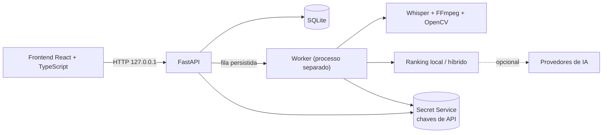

<div align="center">

# 🎬 Infinity-OpusClip (LocalClip)

**Transforme vídeos longos em cortes curtos prontos para TikTok, YouTube Shorts e Instagram Reels, direto na sua máquina.**


</div>

---

## ✨ Visão geral

O **LocalClip** é um editor de vídeo *local-first* que analisa vídeos longos (arquivo ou URL pública), encontra os melhores momentos e entrega **candidatos a cortes curtos** que você revisa, edita, renderiza e exporta.

- A **transcrição, a análise de cena, o reenquadramento e o render rodam na sua máquina**. O vídeo não é enviado para serviços externos.
- A **IA externa é opcional**. Sem nenhum provedor configurado, o ranking usa sinais locais (áudio, fala, cenas, ritmo) e declara isso na interface.
- O score se chama **Potencial estimado**. O projeto não promete viralização.

## 🚀 Funcionalidades

| Área | O que faz |
|---|---|
| **Importação** | Upload de arquivo ou URL pública (via `yt-dlp`). O nome do projeto vem do título do vídeo ou do arquivo e pode ser renomeado. |
| **Miniaturas** | Cada projeto mostra a thumbnail do vídeo para fácil identificação. |
| **Transcrição** | Whisper local (`faster-whisper`) com timestamps por palavra. |
| **Análise** | Detecção de cenas, rostos (OpenCV) e sinais de áudio. Gera uma timeline com tempos absolutos da fonte. |
| **Durações** | Seleção de **uma ou várias faixas** de duração. Os cortes variam entre as faixas escolhidas. |
| **Quantidade automática** | Gera quantos cortes de qualidade houver, sem repetir o mesmo momento do vídeo. |
| **Reframe e legendas** | Reenquadramento inteligente de rosto e legendas queimadas sempre ativos na geração. |
| **Formatos** | 9:16, 1:1 e 16:9, saída H.264/AAC. |
| **Editor** | Ajuste de início/fim, título, legendas, enquadramento manual e remoção de trechos internos. Edição não destrutiva. |
| **Provedores de IA** | OpenRouter, OpenAI, Google Gemini, Anthropic Claude, Z.AI (GLM), endpoints compatíveis com OpenAI (Ollama/local) e contas logadas via OMP. |
| **Fallback e retomada** | Se um provedor falhar por cota, indisponibilidade, crédito esgotado ou credencial rejeitada, o job passa ao próximo da ordem configurada. Um botão **Tentar novamente** retoma o job do checkpoint, sem baixar nem transcrever de novo. |
| **Uso** | Chamadas, tokens, duração e erros por provedor, quando informados. |

## 🧱 Arquitetura



| Camada | Tecnologia |
|---|---|
| Backend | Python, FastAPI, Uvicorn, SQLite (WAL) |
| Worker | Processo separado, um job pesado por vez, cache de análise |
| Mídia | FFmpeg/ffprobe, PyAV, OpenCV, faster-whisper, yt-dlp |
| Frontend | React 18, TypeScript, Vite, lucide-react |
| Segredos | FreeDesktop Secret Service (`keyring`, `secretstorage`) |

Estrutura do repositório:

```text
├── src/localclip/    # app.py, jobs.py, media.py, visual.py, ranking.py, providers.py, storage.py, schemas.py
├── web/              # Frontend React/TypeScript (Vite)
├── scripts/          # supervisor.py (iniciar, parar, reiniciar, status)
├── tests/            # Suíte pytest
├── docs/             # Documentação técnica detalhada
├── iniciar.sh        # Inicia o servidor e abre o navegador
├── parar.sh          # Encerra servidor e workers
└── *.desktop         # Lançadores gráficos (GNOME/KDE)
```

## 📋 Requisitos

- Linux (desenvolvido e testado no Fedora, GNOME e KDE)
- Python **3.12 ou 3.13**
- [uv](https://docs.astral.sh/uv/)
- FFmpeg e ffprobe
- Node.js e npm (para compilar o frontend)
- Serviço **Secret Service** ativo (GNOME Keyring ou KWallet) para guardar chaves de API

## ⚡ Instalação e execução

```bash
git clone https://github.com/bryanmeissner/Infinity-OpusClip.git
cd Infinity-OpusClip

# Dependências do sistema (Fedora)
sudo dnf install python3.12 ffmpeg nodejs npm

# Dependências do projeto
uv sync --python 3.12 --extra dev
npm --prefix web install
npm --prefix web run build

# Iniciar
./iniciar.sh
```

O `iniciar.sh` compila o frontend se necessário, sobe o servidor e abre o navegador em **http://127.0.0.1:8765**.

| Comando | Efeito |
|---|---|
| `./iniciar.sh` | Inicia servidor e abre o navegador |
| `./iniciar.sh --headless` | Inicia sem abrir o navegador |
| `./iniciar.sh status` | Mostra o estado da instância |
| `./iniciar.sh restart` | Reinicia na mesma porta |
| `./parar.sh` | Encerra servidor e workers com segurança |
| `uv run localclip --port 8765` | Execução manual, sem supervisor |

Também é possível usar os lançadores `Iniciar LocalClip.desktop` e `Parar LocalClip.desktop`. O passo a passo para GNOME e KDE está em [`docs/SETUP.md`](docs/SETUP.md).

O primeiro uso da transcrição baixa o modelo Whisper local, o que exige rede. O áudio não é enviado para transcrição remota.

## 🔑 Configurando provedores de IA

Abra **Provedores IA** na interface e escolha uma das opções:

1. **Chave de API**: OpenRouter, OpenAI, Gemini, Anthropic, Z.AI ou endpoint compatível. A chave vai para o Secret Service do sistema e nunca para o SQLite, o Git ou os logs.
2. **Conta logada via OMP**: usa o login da CLI [OMP](https://omp.sh), sem chave de API. Algumas contas do Gemini (Workspace, Code Assist, Vertex AI) exigem informar um **Google Cloud Project ID**. O campo existe na própria tela de login.
3. **Sem provedor**: o ranking local heurístico continua funcionando.

Em **Ordem de Execução do Pipeline**, escolha o provedor principal e o de fallback. A troca para o fallback ocorre quando o principal falha por cota, limite de taxa, indisponibilidade, créditos esgotados ou credencial rejeitada. Se não houver fallback ou se todos os provedores falharem, o job pausa e preserva o checkpoint. Corrija a configuração e use **Tentar novamente** para retomar de onde parou.

## 🧪 Testes

```bash
uv run --extra dev pytest -q          # backend
npm --prefix web run build            # type-check + build do frontend
```

Os testes usam chaves fictícias e mocks. Nenhum deles chama serviços externos nem usa credenciais reais.

## 🔒 Privacidade e segurança

- O servidor escuta **somente em `127.0.0.1`**. Há validação de `Host` e `Origin` e proteção contra CSRF nas mutações.
- Chaves de API ficam no Secret Service. Não existe fallback para texto puro.
- Erros e logs passam por sanitização que remove tokens e parâmetros de query.
- Endpoints de provedor com credenciais na URL, query ou fragmento são rejeitados.
- Os dados ficam em diretórios XDG privados (`~/.local/share/localclip`, `~/.cache/localclip`). Nada disso é versionado.
- O arquivo original nunca é alterado.

Detalhes em [`docs/SECURITY.md`](docs/SECURITY.md).

## 📚 Documentação

| Documento | Conteúdo |
|---|---|
| [`docs/PROJECT_OVERVIEW.md`](docs/PROJECT_OVERVIEW.md) | Visão geral e escopo |
| [`docs/ARCHITECTURE.md`](docs/ARCHITECTURE.md) | Componentes e fluxo |
| [`docs/SETUP.md`](docs/SETUP.md) | Instalação, lançadores e supervisor |
| [`docs/PROVIDERS.md`](docs/PROVIDERS.md) | Provedores, autenticação e adapters |
| [`docs/AI_PIPELINE.md`](docs/AI_PIPELINE.md) | Pipeline de IA, cache e fallback |
| [`docs/VIDEO_PIPELINE.md`](docs/VIDEO_PIPELINE.md) | Ingestão, transcrição, reframe e render |
| [`docs/VIRALITY_RANKING.md`](docs/VIRALITY_RANKING.md) | Fórmula do Potencial estimado |
| [`docs/DATA_MODEL.md`](docs/DATA_MODEL.md) | Esquema do banco e dos arquivos |
| [`docs/UI_UX.md`](docs/UI_UX.md) | Contratos de interface |
| [`docs/TESTING.md`](docs/TESTING.md) | Evidências de verificação |
| [`docs/DECISIONS.md`](docs/DECISIONS.md) | Decisões de projeto |
| [`docs/CURRENT_STATUS.md`](docs/CURRENT_STATUS.md) | Estado atual e limitações |

## ⚠️ Limitações conhecidas

- A qualidade semântica depende do provedor de IA. Sem provedor, o ranking é heurístico.
- A prévia no editor é aproximada. O render final é a referência.
- O suporte oficial é Linux. Outros sistemas não foram testados.
- Use somente vídeos que você tem direito de processar. O projeto não contorna DRM nem usa cookies privados.

## 🗺️ Não objetivos

Editor multitrilha profissional, publicação automática nas redes, analytics social, nuvem obrigatória e treinamento de modelo próprio.

## 📄 Licença

Todos os direitos reservados. O código está público para consulta, mas não há licença que autorize cópia, modificação ou redistribuição sem permissão do autor.

---

<div align="center">

Feito por [@bryanmeissner](https://github.com/bryanmeissner)

</div>
